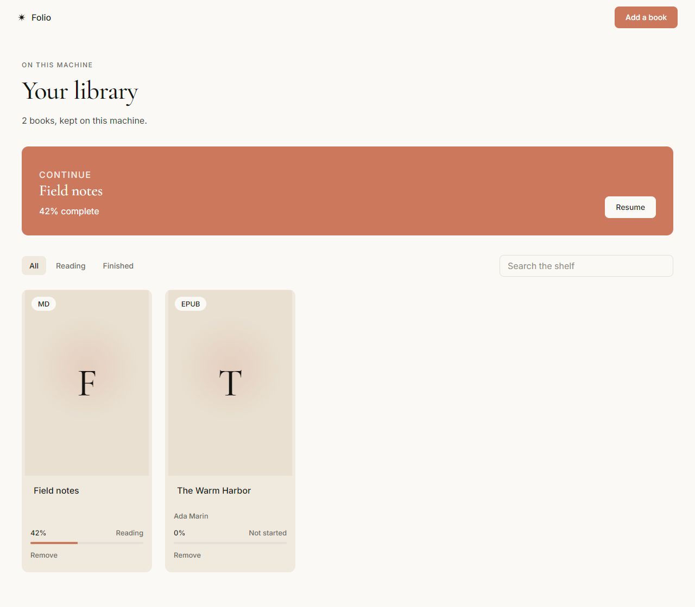
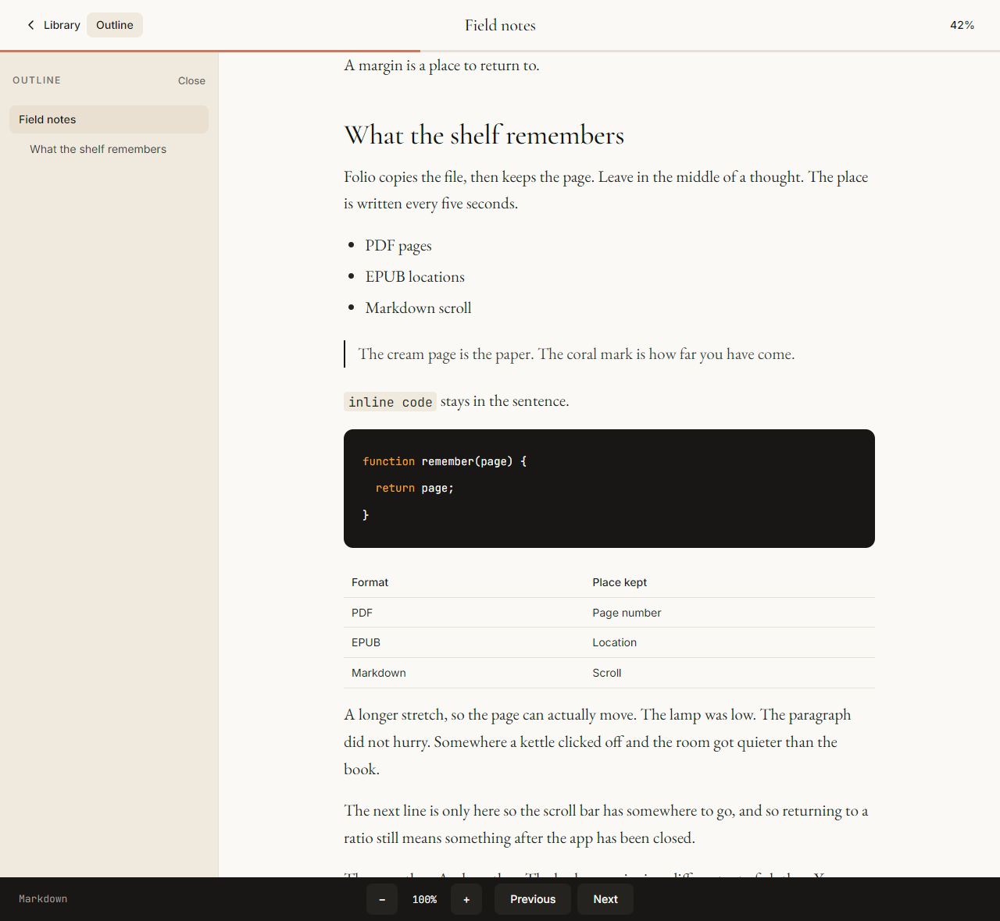

# Folio

A local shelf for PDF, EPUB, and Markdown. Folio copies each book onto your machine, opens it where you left off, and never asks for an account.

[](https://github.com/Ibrahimrahhal/Folio/actions/workflows/ci.yml)
[](LICENSE)

<p align="center">
  
</p>

<p align="center">
  
</p>

## Download

Grab the latest build from [Releases](https://github.com/Ibrahimrahhal/Folio/releases/latest).

| Platform | File | |
| --- | --- | --- |
| Windows | `Folio-<version>-Windows.exe` | Portable. No installer. |
| Windows | `Folio-Setup-<version>.exe` | Start menu shortcut. |
| macOS | `Folio-<version>-macOS.dmg` | Drag Folio to Applications. |
| Linux | `Folio-<version>-Linux.AppImage` | `chmod +x`, then run it. |
| Linux | `Folio-<version>-Linux.deb` | Debian and Ubuntu. |

The downloads are unsigned. Windows SmartScreen and macOS Gatekeeper will warn the first time. On Windows, choose **More info**, then **Run anyway**. On macOS, right-click the app and choose **Open**.

Replacing the app does not touch your library.

## What it keeps

- **PDF, EPUB, and Markdown** on one shelf, with a cover or a monogram when a file has none.
- **Your place.** PDF page, EPUB location, and Markdown scroll are written every five seconds while you read, so a crash still brings you back. Nothing is saved only on quit.
- **Zoom per book**, from 70% to 200%.
- **A closable outline.** PDF bookmarks, the EPUB table of contents, and Markdown headings. HTML buried in a heading, including anchor tags, is shown as text.
- **Search, Reading, and Finished** filters, and a continue card for the book you last left open.

Books are copied into Folio’s own folder. The original file can be moved or deleted.

| System | Library |
| --- | --- |
| Windows | `%APPDATA%\Folio\library` |
| macOS | `~/Library/Application Support/Folio/library` |
| Linux | `~/.config/Folio/library` |

## Develop

Node.js 22 or newer.

```bash
npm install
npm run dev
```

`npm run dev` opens the Electron window against the Vite server. `npm run dist` builds a portable `Folio.exe` on Windows. `npm start` builds the interface and opens it without the dev server.

```bash
npm test
```

## License

[MIT](LICENSE)
